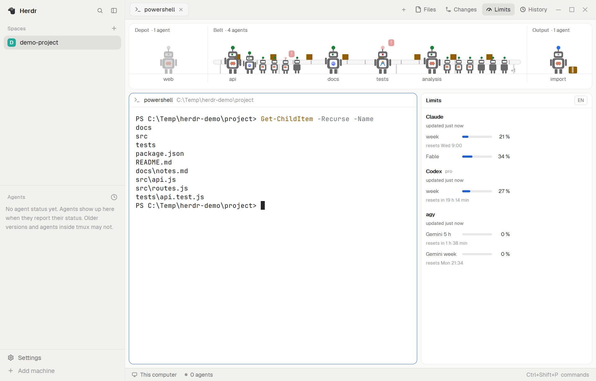

# Assembly line

A working Herdr window for coding agents on Windows with an assembly line above the terminals. Every agent is a small robot that waits in the Depot, walks onto the moving Belt while it works or waits for you, and stands in the Output next to a finished box when it is done. Its Claude Code subagents, background commands and helper terminals stand beside it as smaller robots. The left sidebar lists spaces and agents as a tree, and a panel on the right shows Files, Changes, the usage of your Claude, Codex and agy subscriptions (Limits) or past conversations for the current folder (History).



## What you see

The window has no system title bar. Colors are theme colors, so the window follows light and dark themes. From left to right and top to bottom:

- **Sidebar**, 268 px wide (44 to 480 px), on `chrome`.
  - A 46 px top row from the shipped chrome mod with the Herdr logo and name, a search button and a sidebar toggle. Dragging it moves the window.
  - The shipped Spaces list and the Agents list below it share the rest of the height equally, each at least 90 px.
  - A 69 px footer with Settings and Add machine.
- **Agents list.** A 41 px header “Agents” (11.5 px, `dim`) with a sort icon. By default the agents are in priority sections “Needs you”, “Done”, “Working” and “Idle”, or grouped by space, with pinned agents on top under “Pinned”. An agent row is 30 px high with radius 8, a 16 px program icon, the name, the time since its status changed (“<1m”, “12m”, “3h”, “2d”, 11 px `dim`) and a status mark. The focused row is on `selected`. Subagents, background commands and helper terminals are 26 px rows under their agent, indented 39 px, with 1.5 px tree lines in `input`. A subagent started by another subagent sits under that one.
- **Top bar**, 42 px, on `chrome` with a 1 px bottom border. Dragging it moves the window.
  - The tabs of the shown space as pills 29 px high, radius 7, 12.8 px text, a 14 px program icon and a name up to 170 px. The selected pill is on `raised` with a `border` outline and a close icon. A working tab shows a 12 px spinner in `working`, a blocked or done tab a 6 px dot in `blocked` or `done`.
  - A 26 px “+” button.
  - Panel buttons Files, Changes, Limits and History, 26 px high, radius 6, 12 px text and a 14 px icon. The open one is on `selected`.
  - On Windows, minimize, maximize or restore and close icons (16 px in 26 px buttons).
- **Assembly line**, 150 px. A card with an 8 px margin on the left, right and top, radius 10, on `background` with a 1 px `border`.
  - Three zones from left to right, Depot, Belt and Output, split by 1 px `border` lines. Each has a heading 6 px from the top, the zone name (10.5 px semibold `dim`) and the count such as “3 agents” in `muted`.
  - Depot takes what its robots need within 17 to 30 % of the width, Output within 14 to 30 %, and the Belt gets the rest. Robots are centered in their zone 12 px from its edges with up to 48 px between them, and they overlap when there is no room.
  - A 1 px `border` floor line 108 px from the top of the card. The belt runs across the Belt zone 78 px from the top as a 10 px bar on `raised` with an `input` border and radius 5, with slats in `dim`, boxes “██” in `ansi3` riding on it and six 3 px legs in `input`.
  - Robots stand on the floor. An agent is 36 × 60 px, a helper terminal 29 × 48 px, a subagent or background command 21.5 × 36 px. The body is `muted`, the chest shows the program icon (12 px at full size) on a `background` plate. Under each agent an 84 px name tag (11 px), the tab name if someone named the tab, else the space name. The focused agent's name is `foreground` and semibold, the others `muted`.
  - At most six helpers stand by a robot, then “+N” in 11 px `dim`. Without agents the Depot says “no agents”.
- **Terminals.** The panes of the shown tab as cards on `background`, 1 px `border` (`accent` while focused), radius 10, 8 px apart, with a 30 px pane header on top. A single pane is framed too. The terminals and the right panel sit 8 px in from the edges and 8 px apart.
- **Right panel**, 368 px (280 to 900 px), hidden at start. It shows one of Files, Changes, Limits or History.
- **Limits.** A card with radius 10, a 1 px `border` and 11 px text.
  - A 32 px header with “Limits” in semibold and the EN/SK button (20 px high, radius 5, 10 px text, `input` border, `muted` text).
  - Sections Claude, Codex (with the plan name in 10 px `dim`) and agy, 14 px apart. Each has an age line such as “updated 3 min ago” (10 px, `muted`, `dim` when older than 60 minutes) and a row per window.
  - A row is the window name (72 px, `muted`), a bar up to 64 px wide and 5 px high on a `border` track, and the percentage such as “42 %”. The bar is `accent` below 80 %, `blocked` from 80 % and `ansi1` from 95 %. Under it in 10 px `dim` “resets in 2 h 15 min” within 24 hours, else “resets Thu 14:20”. A row whose reset is within 2 minutes of the row above leaves it out.
  - Claude has “5 hours”, “week” and a row for each model with its own weekly limit. Codex names its windows by length (“5 hours”, “week”, else minutes). agy has a row per window of its own models, third-party windows left out.
  - Before the first read a section says “loading…”, without data “no data”. When agy has no data and no status line file, it adds “agy does not write usage locally”. A failed Claude refresh adds a 10 px line “automatic refresh of Claude usage failed” with the exit code and up to 160 characters of the error.
- **History.** A card with radius 10, a 1 px `border` and 13 px text.
  - A 42 px header with “History” in semibold and under it the folder name or “all folders” (11 px `dim`).
  - A row with the search field (30 px, radius 7, `input` border, a 13 px search icon, placeholder “search titles…”), the “everywhere” switch (24 px, radius 6, 11 px text, `accent` fill with `accent_foreground` text when on) and the EN/SK button (24 px, styled like the switch when off).
  - Up to 40 rows, 30 px high with radius 8, a 16 px program icon, the title, in everywhere mode the folder name (up to 110 px, 11 px `dim`) and on the right the age (“now”, “12 min”, “3 h”, “2 d”, 11 px `dim`) or “running” in `working`.
  - A footer such as “showing 40 of 112” or “found 3 of 40”, and states such as “no conversations in this folder”, “nothing found” and “history could not be loaded”.
- **Status bar**, 28 px, the shipped one with the machine, branch, number of agents and the command palette hint.

## How it behaves

- **working.** A spinner turns once per 900 ms in the Agents list and on the tab. The robot stands on the Belt, its arms swing (600 ms), its eye scans left and right (1.4 s) and its antenna light blinks green `ansi2` (700 ms). While any agent works, the belt runs toward the Output, one character every 140 ms. Working subagents and background commands bob 2 px (500 ms).
- **blocked.** A “Needs you” pill in `blocked` on `blocked` at 15 % opacity (a 14 px “!” square in the priority sections) and a dot on the tab. The robot stands on the Belt with a red `ansi1` light blinking (1 s), a red eye and a red “!” badge pulsing above it (900 ms).
- **done.** A 7 px dot in `done` and a dot on the tab. The robot stands in the Output with a `done` light and a cardboard box (18 × 15 px, `ansi3`) beside it.
- **idle.** A 7 px ring in `idle`. The robot waits in the Depot at 45 % opacity with its eye still. An idle agent whose subagent still works shows that status in the list but its robot stays in the Depot.
- **Moves.** When an agent's status changes, its robot and helpers slide to the new zone in 1 s (ease-in-out), and the zone lines, headings and the belt slide with them. Fading takes 0.4 s.
- **Agents list clicks.** A row focuses the agent's pane. A subagent or command row focuses its agent, a helper terminal without a pane opens in a peek. The program icon or the chevron folds the rows under an agent, a section header folds the section. Hovering a row swaps the time for a pin button. The sort icon opens a menu with Priority and Grouped by space. Narrower than 160 px, the list becomes a rail of numbered rows with a “»” button that widens the sidebar again.
- **Top bar clicks.** A click selects a tab, a double click renames it, dragging reorders tabs, a right click opens the tab menu and the mouse wheel moves to the next or previous tab. “+” opens the new terminal menu. A panel button opens the right panel on that panel, a second click hides it. Each space remembers its open panel.
- **Assembly line clicks.** A robot focuses its agent's pane, a subagent or command focuses its agent's pane, and a helper terminal opens in a peek. Hovering shows the name, space, program and status.
- **History clicks.** A row resumes the conversation in a new tab of the current space. In everywhere mode it opens in the conversation's own folder, in the space named like that folder, else the space with the most terminals running there, else a new space. Running rows and rows whose folder is gone are muted and do nothing. Typing filters by title, program and folder name, ignoring case and diacritics, and Esc clears the field. The field takes the keyboard only after a click into it. A new active folder reloads the list.
- **Language.** The EN/SK button in Limits or History switches Limits, History, the assembly line and the two bar buttons between English and Slovak at once, and the button shows the current language. English is the default and the choice survives a restart. The Agents list, Files and Changes stay in English.
- **Refresh.** Limits reads its status line files every 15 s and Codex sessions and Claude's cached usage every 60 s. It asks Claude Code for fresh usage when it opens, then at most every 5 minutes while any agent works or waits, else once an hour. It asks Codex and agy when it opens and then once an hour. History reloads every 60 s, in everywhere mode every 5 minutes. The Agents list redraws its times every 30 s. The assembly line and the bar have no timers and redraw on Herdr's live data.

## Built from

The layout `layouts/pasova-vyroba.json`:

```text
root            row, background canvas, divider 1 border, titlebar none, traffic_lights [12, 16], terminal_padding [14, 12]
├ sidebar       column, px 268, min 44, max 480, background chrome, resizable false
│ ├ brand            block workspace-chrome, px 46, window_drag
│ ├ sidebar-lists    column
│ │ ├ spaces         block spaces, weight 1, min 90
│ │ └ agents         block agents-tree, weight 1, min 90
│ └ sidebar-footer   block workspace-chrome, props { "footer": true }, px 69
└ work          column, resizable false
  ├ tabs        block panely, px 42, window_drag
  ├ pas         block pas, px 150
  ├ work-body   row, padding 8, gap 8
  │ ├ main      block { "tab": "active" }, pane: header mod pane (30, top, reveal always),
  │ │           background background, border 1 border, focus 1 accent, radius 10, gap 8, lone true
  │ └ panel     column, px 368, min 280, max 900, hidden true
  │   └ panel-body  stack, active files: blocks files, changes, limity, historia (mods of the same names)
  └ status      block workspace-status, px 28
```

Own mods in `mods/`:

- `agents-tree` is a clone of the shipped `agents` from Herdr App 0.1.16 with the `records` rows of Herdr App pull request #1212 and a Windows lookup of subagent parents. Prop `sortMenu` draws its own sort popup. It keeps `changed` and `pins` in `localStorage` and writes the shared values `agents.sort`, `sidebar.width` and `sidebar.collapsed`.
- `panely` is a clone of the shipped `tabs` from 0.1.16 with the Limits and History buttons. It keeps `panels` (open panel per space) in `localStorage`, reads the shared `workspace.panels` and always adds `limity` and `historia` to the buttons it shows.
- `limity` has no props. `historia` takes `filter` (start text of the search field) and `vsade` (true starts in everywhere mode). `pas` is `main.js` with the art in `art.js` and takes `demo` (true draws a fixed demo crew and turns clicks off).
- `limity` and `historia` write the shared value `windows-mods.lang` (`en` or `sk`, missing means `en`), and all four read it.

Shipped mods it uses are `workspace-chrome`, `spaces`, `pane`, `files`, `changes` and `workspace-status` as blocks, and `menu` (200 px popup) and `new-menu` (250 × 512 popup) as overlays. Icons come from `mods/workspace-chrome/` (`search`, `spinner`, `chevron-down`, `chevron-right`, `pin`, `pin-off`, `clock`, `layers`, `check`), `mods/pane/close.svg`, `mods/files/file.svg`, `mods/changes/changes.svg` and the program icons in `icons/`, and the own `limity.svg`, `historia.svg` and `win-*.svg`.

`herdr` functions are `agents`, `terminals`, `panes`, `focused`, `spaces`, `layout`, `window`, `theme`, `settings`, `props`, `shared`, `setShared`, `setAgentOrder`, `openOverlay`, `closeOverlay`, `checking`, `home`, `readTextFile`, `knownAgents` (History, for program icons), `exec` and `run`. Commands:

- `agents-tree` runs `pane.focus`, `terminal.peek`, `terminal.pin` and `layout.resize`.
- `panely` runs `tab.select`, `tab.rename`, `tab.move`, `tab.close`, `tab.next`, `tab.prev`, `layout.select`, `layout.show`, `layout.hide`, `window.minimize`, `window.maximize` and `window.close`.
- `pas` runs `pane.focus` and `terminal.peek`. `historia` runs `tab.new`, `space.new` and `space.select`.

Every program the mods run, all through `exec`, with what they read outside their own folder:

| Mod | Program | When | Reads or reaches |
|---|---|---|---|
| `agents-tree` | `powershell -NoProfile -Command <META_WIN><pid>`, 8 s limit | for each new Claude Code subagent until found, at most 6 tries 0.5, 1, 2, 4 and 8 s apart | `~\.claude*\sessions\<pid>.json` (`sessionId`), `~\.claude*\projects\*\<sessionId>\subagents\agent-*.meta.json` (`parentAgentId`, `description`) |
| `agents-tree` | `sh -c <META> sh <pid>` with `on`, 8 s limit | the same for an agent on another machine, or outside Windows | the same files there |
| `limity` | `powershell -NoProfile -Command <CODEX_PS>` | every 60 s | the last 20 lines of the 5 newest `~\.codex\sessions\**\rollout-*.jsonl`, prints only the last `rate_limits` |
| `limity` | `powershell -NoProfile -Command <CLAUDE_MODELY_PS>` | every 60 s and after each `claude -p /usage` | all of `~\.claude.json` (account e-mail and settings too), prints only percentages and reset times from `cachedUsageUtilization` |
| `limity` | `claude -p /usage --no-session-persistence --strict-mcp-config` in `~`, 60 s limit | at open, then at most every 5 minutes while an agent is working or blocked, else hourly | network through Claude Code's own sign-in, which stores the usage in `~\.claude.json` |
| `limity` | `node -e <CODEX_SERVER_JS>`, which starts `codex app-server` and sends `initialize`, `initialized` and `account/rateLimits/read` | at open and hourly, server killed after 20 s | network through Codex's own sign-in |
| `limity` | `agy -p /usage --output-format json --print-timeout 1m` in `~`, 60 s limit | at open and hourly | network through agy's own sign-in |
| `historia` | `powershell -NoProfile -Command <HISTORIA_PS> '<folder>' $false` (`'' $true` in everywhere mode), 30 s limit | every 60 s, in everywhere mode every 5 minutes | the files listed below, and `Get-Process` for running Claude sessions |

`limity` also reads `~/.cache/limity/claude.json` and `~/.cache/limity/agy.json` with `readTextFile` every 15 s. The optional status line scripts in `doplnky\` of the repository write them. `historia` reads, inside its PowerShell command:

- Claude Code — `~\.claude\sessions\*.json` and `~\.claude\projects\<folder>\*.jsonl` (the last 64 KiB, then 1 MiB and 8 MiB while no title is found, and the first 1 MiB for the first message and the original folder).
- Codex — `~\.codex\session_index.jsonl`, the first line of `~\.codex\sessions\**\rollout-*.jsonl` and the first 1 MiB of a transcript without a title.
- agy — in `~\.gemini\antigravity-cli` the files `history.jsonl`, `cache\conversation_metadata.json`, `annotations\<id>.pbtxt`, the first line of `brain\<id>\.system_generated\logs\transcript.jsonl` and the times of `conversations\*.db`.

Only a title or the first 60 characters of the first message reach the panel. A click in History starts `claude --resume <id>`, `codex resume --no-daemon <id>` or `agy --conversation <id>` as the `argv` of a new tab, and that agent then works and connects as usual. `pas` and `panely` run nothing and read no files. No mod calls `fetch` or reads sign-in files.

The robot in `art.js` is absolutely placed rectangles in units of a 36 × 60 robot, multiplied by the scale (1 for an agent, 0.8 for a helper terminal, 0.6 for a subagent or command) and rounded to half a pixel. In drawing order:

```text
legs 6×10 at (10,50) and (20,50)        body 26×23 at (5,27) r5
chest plate 16×16 at (10,30) r3 + icon 12 at (12,32), only with a program icon
arms 4×15 at (0,29) and (32,29) r2      head 20×14 at (8,12) r4
visor 14×6 at (11,16) r2                eye 4×4 at (16,17) r2 (arms and eye: agents and helper terminals)
antenna 2×6 at (17,7)                   light 8×8 at (14,0) r4
```

The belt is two text rows in Cascadia Mono 11 px with the period-12 patterns `"|     |     "` and `"     ██     "`. A running belt is `frames()` of 12 shifted copies, 140 ms each. Everything else moves with `loop()` and `transition()` on stable element ids (`g-<address>`, `r-<address>`, `h-<id>`), drawn in a fixed order by id.

## Watch out

- Windows only, with Windows PowerShell 5.1. Its `ConvertFrom-Json` fails on `~\.claude.json` and on keys that differ only in case, so `CLAUDE_MODELY_PS` and `HISTORIA_PS` parse JSON with `System.Web.Script.Serialization.JavaScriptSerializer`. The PowerShell strings contain no double quotes (`[char]34` instead) so they pass through process arguments, and they set UTF-8 output.
- `exec` cannot write to a program's input and PowerShell 5.1 puts a BOM before the first message, on which `codex app-server` fails. That is why the Codex request goes through `node -e`.
- `agents-tree` and `panely` are clones of the shipped `agents` and `tabs` from Herdr App 0.1.16, and the layout is a clone of `main` from 0.1.16. They do not follow Herdr updates.
- `agents-tree` is also the name of the community mod `h0ru5/herdr-agents-tree`. Renaming a mod means its folder, `content.mod` in the layout, its own `mods/<name>/` icon paths, `openOverlay({ mod: "agents-tree" })` for the sort popup, and in `panely` the icon paths `mods/limity/limity.svg` and `mods/historia/historia.svg`. The stack children `limity` and `historia` are block ids, which `panely` selects by name.
- Undocumented sources that can change without notice — `cachedUsageUtilization` in `~\.claude.json`, the experimental `account/rateLimits/read` of `codex app-server`, the JSON of `agy -p /usage`, Claude Code's `agent-*.meta.json`, and the `records` field of `terminals()`, which `herdr.d.ts` does not describe and which needs Claude Code 2.1.329 or later for background commands.
- The belt needs the Cascadia Mono font, which comes with Windows Terminal.
- Without the status line scripts from `doplnky\`, which are not part of this layout, Limits has no five-hour Claude window and refreshes agy only hourly.
- Limits marks a value older than 60 minutes as old, colors bars at 80 and 95 %, waits 60 s for `claude` and `agy` and kills the Codex server after 20 s.
- History loads at most 500 conversations and shows 40. Codex threads packed as `.jsonl.zst` (older than about 6 days) are not read. “running” for Codex and agy means the file changed in the last 120 s. agy lists only conversations typed in a terminal (`history.jsonl`). Everywhere mode skips folders under `%TEMP%`, and History does not work for spaces on another machine. `codex resume --no-daemon` needs a Codex that knows the switch.
- The assembly line draws no nesting. It estimates the elements of a scene and keeps them at 250 or fewer, so the helper limit drops from 6 to 4, 2 or 0 with many agents.
- `agents-tree` gives up on a subagent's parent after 6 tries and shows it straight under its agent.
- `limity` and `historia` return early from `init()` when `checking()` is true, so `herdr-app check` starts no programs. `pas` draws for 1000 px at zoom 1 during a check.
- App zoom. `pas` treats the width from `on_size_change` as already multiplied by the zoom, while `.w()` and `.left()` multiply by it themselves and `loop()` positions do not. It measures the zoom with a hidden 100 px wide element, divides its width by it and multiplies the `loop()` values for `top` and `left` by it. Without this the scene is laid out for the wrong width and arms, eyes and bobbing robots move in the wrong place at any zoom other than 100 %.
- Other things a fresh build gets wrong — animating with timers instead of `loop()`, `frames()` and `transition()`, running the belt with `loop()` (it swings back and forth, while `frames()` runs one way), and drawing robots without stable ids in a fixed order (they cannot slide).
- `panely` always shows the Limits and History buttons, even when the welcome screen's `workspace.panels` leaves them out.

`doplnky\vychytavky.json` in the repository is the same layout without the `pas` block and with a 170 px minimum for the right panel.

## Done when

1. `herdr-app check <mods folder>\<name> | Out-String` passes for `agents-tree`, `limity`, `historia`, `pas` and `panely`.
2. After `herdr-app do layout.switch --name pasova-vyroba`, `herdr-app status | Out-String` names that layout and its `errors` field is empty.
3. With `"props": { "demo": true }` on the `pas` block, the headings read Depot · “1 agent”, Belt · “4 agents” and Output · “1 agent”. “web” is faded in the Depot, “tests” has a red “!”, “import” stands by a box, “analysis” has six helpers and “+1”, and the belt runs.
4. A click on EN/SK in Limits changes “Limits” to “Limity”, the History header to “História”, both bar buttons, and the zones to “Depo”, “Pás” and “Výstup”. After a restart of Herdr the language is the same.
5. A panel button opens the right panel on that panel and a second click hides it. Another space keeps its own choice.
6. With `claude` signed in and in PATH, Limits shows the Claude week with an age line and no “automatic refresh of Claude usage failed” line. Codex and agy show rows or “no data”.
7. In a folder with past Claude Code conversations, History lists them with ages, typing filters the list, Esc clears it, and a click on one that is not running opens a new tab with `claude --resume <id>`. “everywhere” adds folder names.
8. A Claude Code subagent shows as a row under its agent and as a small robot beside its robot, and both go when it finishes.
9. When an agent starts working, its robot slides from the Depot onto the Belt and the belt starts to run.
